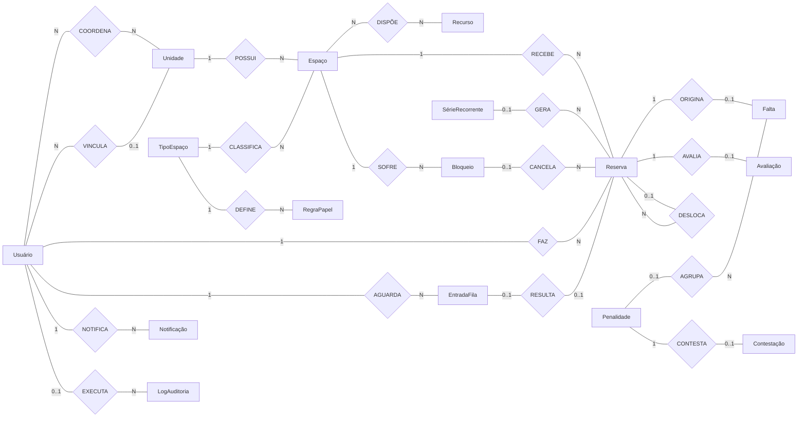
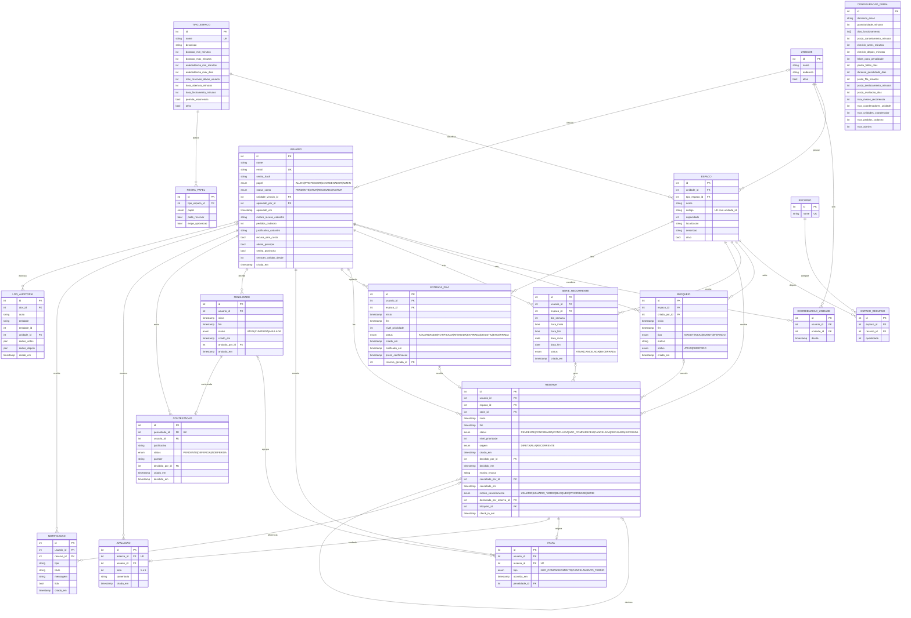

# Domain Model — BookingSystem

> Conceitos fundamentais do domínio, seus relacionamentos e regras estruturais.
> Este documento contém o **MER** (modelo conceitual) e, no Apêndice A, o **DER** (modelo lógico de referência).
>
> **Importante:** o modelo é **global**, mas a implementação física é **incremental**. As tabelas no Xano são criadas apenas quando uma change do OpenSpec precisar delas. Nomes e tipos do DER podem ser ajustados no `design.md` de cada change, desde que os conceitos e as regras deste documento sejam preservados.

---

## 1. Visão geral do domínio

```text
Unidade
  ├── Espaço ───────────── TipoEspaço ── RegraPapel (por papel)
  │     ├── Recurso (N:N)
  │     ├── Bloqueio
  │     ├── SérieRecorrente ── Reserva (ocorrências)
  │     ├── Reserva
  │     │     ├── Falta ── Penalidade ── Contestação
  │     │     ├── Avaliação
  │     │     └── Notificação
  │     └── EntradaFila ── (gera) Reserva
  └── Coordenadores (Usuário N:N Unidade)

Usuário (Aluno | Professor | Coordenador | Admin)
  ├── Reserva / SérieRecorrente / EntradaFila
  ├── Falta / Penalidade / Contestação
  ├── Avaliação / Notificação
  └── LogAuditoria (como ator)

ConfiguraçãoGeral (parâmetros globais — registro único)
```

---

## 2. Conceitos

### 2.1 Usuário

Pessoa que acessa o sistema. Tem exatamente **um papel**.

**Principais informações:**
- nome, e-mail institucional (único) e senha (hash);
- papel (`ALUNO`, `PROFESSOR`, `COORDENADOR`, `ADMIN`) e situação da conta (`PENDENTE`, `ATIVA`, `RECUSADA`, `INATIVA`);
- unidade de vínculo: para pedido `PENDENTE` ou `RECUSADA`, é a **unidade pedida**; para professor ativo, é a **unidade a que ele pertence**; para aluno e coordenador ativos, fica vazia;
- decisão do pedido: quem decidiu, quando e o motivo da recusa;
- pedidos de cadastro enviados, justificativa do reenvio e se a última recusa foi automática por desativação da unidade;
- se é o **administrador principal**, se a **senha é provisória** e a partir de quando as sessões valem (instante da última troca ou redefinição de senha).

**Relacionamentos:**
- Faz várias reservas, séries recorrentes e entradas em fila.
- Pode coordenar várias unidades (se coordenador).
- Possui faltas, penalidades, contestações, avaliações e notificações.
- É o ator dos registros de auditoria.

**Regras estruturais:**
- O **nível de prioridade** deriva do papel: Aluno = 1, Professor = 2, Coordenador = 3, Admin = 3.
- Conta de aluno nasce `ATIVA`.
- Conta de professor nasce `PENDENTE` e só fica `ATIVA` após aprovação de um admin ou de um coordenador ativo da unidade pedida.
- Conta de coordenador nasce `PENDENTE` e só fica `ATIVA` após aprovação de um admin; ao ser aprovada, passa a coordenar a unidade pedida.
- A recusa exige motivo. O titular pode reenviar o pedido até o limite de pedidos; a recusa automática por desativação da unidade não consome pedido. Só o admin aprova conta `RECUSADA`.
- Só contas `ATIVA` podem autenticar. Com senha provisória, a conta só consulta os próprios dados e troca a senha.
- Um admin inativa uma conta `ATIVA` com motivo (registrado só na auditoria) e reativa uma conta `INATIVA`. As coordenações ficam guardadas durante a inativação; na reativação, só as de unidades ativas e com vaga continuam. Professor com unidade desativada recebe nova unidade, e admin só volta se houver vaga no limite.
- Trocar ou redefinir a senha invalida os tokens emitidos antes. A redefinição pelo admin deixa a senha provisória.
- O papel `ADMIN` é atribuído somente pelo **admin principal**, criando a conta (com senha provisória) ou promovendo um coordenador ativo, que perde as coordenações; o cadastro nunca o concede. Há no máximo `max_admins` admins `ATIVA`, contando o principal.
- Existe exatamente **um admin principal**. Ele não é alvo de nenhuma operação sobre contas. Admins secundários só são inativados, reativados, rebaixados (somente a `COORDENADOR`, com de 1 a 2 unidades) ou têm a senha redefinida pelo principal.
- Mudança de papel (só admin, conta `ATIVA`): `ALUNO` → `PROFESSOR` → `COORDENADOR`, e `COORDENADOR` → `PROFESSOR`. Ninguém volta a `ALUNO`. Virar professor exige unidade; virar coordenador exige de 1 a 2 unidades.
- O professor pertence a uma unidade e só o admin o transfere. O aluno pertence à instituição.

### 2.2 Unidade

Campus ou prédio da instituição.

**Principais informações:** nome; endereço; ativa.

**Relacionamentos:** possui vários espaços, professores (pertencimento) e de 0 a 4 coordenadores (N:N com Usuário).

**Regras estruturais:**
- Coordenadores só visualizam e alteram dados (espaços, bloqueios, reservas pendentes, aprovação de professor) das unidades que coordenam.
- Só o admin cria unidades, sempre com um coordenador (movido ou acrescentado), corrige nome e endereço (nome único sem diferenciar maiúsculas e minúsculas), desativa e reativa. Unidades nunca são excluídas.
- Desativar uma unidade exige destino para cada coordenador que só coordena ela e para cada professor dela. Os pedidos pendentes dela são recusados automaticamente. Reativada, ela volta sem coordenadores e sem professores.
- Desativar ou reativar a unidade não altera os espaços dela. Enquanto ela estiver desativada, os espaços não são reserváveis, e não se cria espaço nela.

### 2.3 Coordenação de Unidade (associativa)

Associa um usuário de papel `COORDENADOR` a uma unidade. Contam apenas coordenadores com conta `ATIVA`.

**Regras estruturais:**
- Todo coordenador ativo coordena de **1 a 2 unidades**; toda unidade tem **no máximo 4 coordenadores**. Os dois limites são parâmetros.
- O admin **acrescenta** uma unidade a um coordenador, **move** um coordenador entre unidades ou **remove** uma das duas unidades dele. Nenhuma dessas operações pode deixar a origem sem coordenador ativo.
- Uma unidade só fica sem coordenador ativo:
  - antes do primeiro ser aprovado;
  - quando o último sai por mudança de papel;
  - depois de ser reativada.

  Nesse caso, o admin cuida dela.
- Remover uma coordenação apaga o vínculo; o histórico fica no log de auditoria.

### 2.4 Tipo de Espaço

Categoria de espaço com regras de uso próprias. Tipos iniciais: **Sala de aula, Laboratório, Biblioteca, Auditório**. O admin pode criar novos tipos.

**Principais informações (regras do tipo):** nome; duração mínima e máxima (minutos); antecedência mínima (minutos) e máxima (dias); máximo de reservas ativas por usuário; horário de abertura e de fechamento, em minutos desde a meia-noite (padrão 08h00 e 22h40); permite recorrência.

**Relacionamentos:** classifica vários espaços; possui uma regra por papel (RegraPapel).

**Regras estruturais:**
- Qualquer admin cria, edita, desativa e reativa tipos. O nome é único, sem diferenciar maiúsculas e minúsculas. Tipos nunca são excluídos.
- Desativar um tipo não altera os espaços dele, mas eles deixam de ser reserváveis. Um tipo desativado não pode ser escolhido para espaços novos nem para a troca de tipo.
- Um tipo só é reservável com **regras completas**: as oito regras preenchidas e uma RegraPapel para aluno e outra para professor. Sem elas, os espaços do tipo não são reserváveis (motivo `TIPO_SEM_REGRAS`) e a página de tipos o destaca como "sem regras".
- Os quatro tipos iniciais recebem as regras numa carga única da carga inicial, feita só enquanto não há nenhuma RegraPapel (valores no `project-overview.md`, §7.2). Os demais tipos, inclusive os criados depois, nascem sem regras até o admin defini-las.
- Abertura e fechamento ficam no mesmo dia (de 0 a 1439 minutos; o fechamento é sempre antes da meia-noite), com a abertura antes do fechamento. Durações e horários são múltiplos da granularidade (§2.18), e a duração máxima cabe no horário do tipo.
- Qualquer admin edita as regras do tipo e a RegraPapel dele, inclusive de tipo desativado. A granularidade e os dias de funcionamento são do admin principal.

### 2.5 Regra por Papel (RegraPapel)

Define, para um tipo de espaço e um papel, **se o papel pode reservar** e **se exige aprovação**.

| Tipo | Aluno | Professor | Coordenador / Admin |
|---|---|---|---|
| Biblioteca | reserva | reserva | reserva |
| Laboratório | reserva **com aprovação** | reserva | reserva |
| Sala de aula | — | reserva | reserva |
| Auditório | — | reserva **com aprovação** | reserva |

**Regras estruturais:**
- Única por (tipo de espaço, papel).
- Guarda só aluno e professor. Coordenador e admin têm regra fixa, sem registro: reservam todos os tipos, sem aprovação.
- Só exige aprovação quem pode reservar.

### 2.6 Espaço

Local físico reservável.

**Principais informações:** nome; código/identificação; capacidade; localização (bloco, andar); descrição; ativo.

**Relacionamentos:** pertence a uma unidade e a um tipo; dispõe de vários recursos; recebe reservas, bloqueios, séries e entradas de fila.

**Regras estruturais:**
- O coordenador cria e edita espaços das unidades que coordena; o admin, de todas.
- O código é único **dentro da unidade**, sem diferenciar maiúsculas e minúsculas, e vale também para espaços desativados.
- Espaços nunca são excluídos: só desativados e reativados.
- **Disponibilidade derivada:** o espaço só é reservável quando ele, a unidade dele e o tipo dele estão ativos. Espaço não reservável não aparece na busca e não aceita novas reservas.
- Quem gere o espaço troca o tipo dele (só para tipo ativo). Só o admin move o espaço para outra unidade ativa, sem colisão de código no destino.

### 2.7 Recurso e Espaço-Recurso

Recurso disponível em espaços (projetor, computadores, ar-condicionado, quadro digital etc.). A associação N:N registra a **quantidade** do recurso em cada espaço. Os recursos são usados como filtro na busca.

**Regras estruturais:** o catálogo é global e mantido só pelo admin (nome único, sem diferenciar maiúsculas e minúsculas). Um recurso só é excluído quando nenhum espaço, ativo ou desativado, o usa. Quem gere o espaço define a lista de recursos dele, com quantidade de pelo menos 1 e sem repetição.

### 2.8 Bloqueio

Período em que um espaço fica indisponível.

**Principais informações:** espaço; início; fim; tipo (`MANUTENCAO`, `EVENTO`, `FERIADO`); motivo; situação (`ATIVO`, `REMOVIDO`); criado por.

**Regras estruturais:**
- Criado por coordenador (da unidade do espaço) ou admin.
- Ao ser criado, cancela as reservas ativas sobrepostas (motivo `BLOQUEIO`, sem penalidade) e encerra as entradas de fila sobrepostas.
- Um bloqueio de feriado para uma unidade inteira é registrado como um bloqueio por espaço.

### 2.9 Reserva

Ocupação de um espaço por um usuário em um intervalo de tempo. É o conceito central do sistema.

**Principais informações:** usuário; espaço; início; fim; situação; nível de prioridade (cópia do nível do usuário no momento da criação); origem (`DIRETA`, `FILA`, `RECORRENTE`); série (se recorrente); data/hora de criação; decisão de aprovação (quem, quando, motivo da recusa); cancelamento (quem, quando, motivo); check-in.

**Ciclo de vida:**

```text
                   ┌──────────── (exige aprovação) ────────────┐
                   │                                           ▼
 [pedido] ──► CONFIRMADA ◄──── aprovada ──── PENDENTE ──► RECUSADA
                   │                            │
                   │                            └──► EXPIRADA (sem decisão até o início)
                   │
                   ├──► CANCELADA  (USUARIO | USUARIO_TARDIO | BLOQUEIO | PRIORIDADE | SERIE)
                   ├──► CONCLUIDA  (check-in feito; após o término)
                   └──► NAO_COMPARECEU (sem check-in na janela)
```

- **Ativas** (ocupam o horário): `PENDENTE` e `CONFIRMADA`.
- **Finais:** `CONCLUIDA`, `NAO_COMPARECEU`, `CANCELADA`, `RECUSADA`, `EXPIRADA`.

**Regras estruturais:**
- `inicio < fim`, mesmo dia, dia útil, dentro do horário do tipo, múltiplos de 10 minutos, respeitando duração mínima e máxima.
- **Não pode haver duas reservas ativas sobrepostas no mesmo espaço** (`a.inicio < b.fim` e `b.inicio < a.fim`).
- Não pode sobrepor uma vaga retida pela fila de espera (entrada `NOTIFICADA`), exceto a reserva gerada pela confirmação dessa própria entrada.
- Não pode sobrepor um bloqueio ativo.
- Cancelamento com motivo `USUARIO_TARDIO` (menos de 2h antes) ou situação `NAO_COMPARECEU` gera uma **Falta**.
- Cancelamento por `PRIORIDADE` registra **qual reserva deslocou** a anterior (autorrelacionamento).
- Cancelamento por `BLOQUEIO` registra **qual bloqueio** o causou.
- Reservas nunca são excluídas fisicamente.

### 2.10 Série Recorrente

Agrupa as ocorrências semanais de uma reserva recorrente de **sala de aula**.

**Principais informações:** usuário; espaço; dia da semana; hora de início e fim; data inicial e final; situação (`ATIVA`, `CANCELADA`, `ENCERRADA`).

**Regras estruturais:**
- Gera várias reservas (origem `RECORRENTE`). Somente tipos com recorrência permitida.
- Período limitado pelo parâmetro global (padrão: 6 meses). As ocorrências são **isentas da antecedência máxima** do tipo de espaço; a antecedência mínima continua valendo.
- Ocorrências conflitantes não são criadas.
- Cancelar a série cancela as ocorrências futuras. As que estiverem a menos de 2 horas do início são canceladas com motivo `USUARIO_TARDIO` e geram falta.

### 2.11 Entrada na Fila de Espera

Pedido de um usuário para ocupar um intervalo exato de um espaço caso ele seja liberado.

**Principais informações:** usuário; espaço; início; fim; nível de prioridade; situação (`AGUARDANDO`, `NOTIFICADA`, `ATENDIDA`, `EXPIRADA`, `DESISTIU`, `ENCERRADA`); data de entrada; data de notificação; prazo de confirmação; reserva gerada.

**Regras estruturais:**
- Só pode ser criada quando o intervalo está ocupado (reserva ativa ou vaga retida) e o usuário não pode deslocar quem o ocupa. Nunca para intervalo livre ou sobreposto a bloqueio ativo.
- Ordem: maior nível de prioridade e, em empate, data de entrada.
- A vaga é liberada para a fila quando o intervalo dela deixa de ter reserva ativa sobreposta.
- Enquanto `NOTIFICADA`, a entrada **retém a vaga**: ocupa o intervalo como uma reserva ativa até passar a `ATENDIDA`, `EXPIRADA` ou `DESISTIU`. A retenção não pode ser deslocada nem tomada por entradas que chegarem depois.
- Se uma liberação abre filas de intervalos sobrepostos, a retenção vai para a fila cujo primeiro colocado tem maior prioridade (empate: entrada mais antiga). As demais são reavaliadas quando a retenção termina sem confirmação.
- O prazo de confirmação é de 2h após a notificação, limitado a 2h antes do início do intervalo da fila.
- A fila do intervalo é encerrada quando faltam menos de 2h para o início do intervalo da fila.
- Um usuário tem no máximo uma entrada ativa por (espaço, intervalo).
- Usuário com penalidade ativa não entra na fila.

### 2.12 Falta

Registro de não comparecimento ou de cancelamento tardio.

**Principais informações:** usuário; reserva (única); tipo (`NAO_COMPARECIMENTO`, `CANCELAMENTO_TARDIO`); data; penalidade que ela gerou (se houver).

**Regra estrutural:** uma reserva gera no máximo uma falta. Uma falta só pode contribuir para uma penalidade.

### 2.13 Penalidade

Impedimento temporário de criar novas reservas e de entrar em filas.

**Principais informações:** usuário; início; fim; situação (`ATIVA`, `CUMPRIDA`, `ANULADA`); quem anulou e quando.

**Regras estruturais:**
- Gerada quando o usuário acumula **2 faltas em 30 dias** ainda não vinculadas a outra penalidade. Duração: **7 dias**.
- Faltas cometidas durante uma penalidade ativa contam normalmente. As penalidades de um usuário **nunca se sobrepõem**: se uma nova for gerada durante uma penalidade ativa, ela começa quando a atual termina. Se uma penalidade for anulada, as encadeadas depois dela são antecipadas: cada uma passa a começar quando teria começado sem a anulada (no mínimo, na data da falta que a gerou).
- Não cancela reservas já confirmadas.
- Só o **admin** anula, e apenas a partir de uma contestação.

### 2.14 Contestação

Justificativa do usuário pedindo a anulação de uma penalidade.

**Principais informações:** penalidade (única); usuário; justificativa; situação (`PENDENTE`, `DEFERIDA`, `INDEFERIDA`); parecer; admin que decidiu; datas.

**Regra estrutural:** uma contestação por penalidade. Se deferida, a penalidade passa a `ANULADA`.

### 2.15 Avaliação

Nota de 1 a 5 e comentário opcional sobre o uso de um espaço.

**Regras estruturais:** apenas para reserva `CONCLUIDA`; uma por reserva; até 7 dias após o término; somente o próprio usuário da reserva; visível a todos.

### 2.16 Notificação

Mensagem in-app para um usuário, opcionalmente ligada a uma reserva.

**Principais informações:** usuário; tipo do evento; título; mensagem; reserva (opcional); lida; data.

### 2.17 Log de Auditoria

Registro imutável de ação sensível.

**Principais informações:** ator (usuário, ou vazio quando a ação é do sistema/tarefa agendada); ação; entidade e identificador afetados; unidade (quando aplicável); dados antes e depois; data/hora.

**Regras estruturais:** somente inserção, nunca alteração ou exclusão. Visível apenas ao admin.

### 2.18 Configuração Geral

Registro único com os parâmetros globais editáveis pelo admin principal. Reduzir um limite não remove ninguém; o novo valor vale para as ações seguintes.

| Parâmetro | Padrão |
|---|---|
| Domínio de e-mail aceito | institucional (ex.: `aluno.impacta.edu.br`, `impacta.edu.br`) |
| Granularidade de horário | 10 min |
| Dias de funcionamento | segunda a sexta |
| Prazo de cancelamento sem penalidade | 120 min antes do início |
| Janela de check-in | 15 min antes até 15 min depois do início |
| Faltas para penalidade / janela | 2 faltas / 30 dias |
| Duração da penalidade | 7 dias |
| Prazo para confirmar vaga da fila | 120 min (limitado a 120 min antes do início) |
| Antecedência mínima para deslocar por prioridade | 120 min |
| Prazo para avaliar | 7 dias |
| Período máximo de recorrência | 6 meses |
| Máximo de coordenadores por unidade | 4 |
| Máximo de unidades por coordenador | 2 |
| Máximo de pedidos de cadastro (cadastro + reenvios) | 3 |
| Máximo de administradores ativos (incluindo o principal) | 3 |

- A granularidade é um divisor de 60 (1, 2, 3, 4, 5, 6, 10, 12, 15, 20, 30 ou 60), e a mudança é recusada se deixar algum tipo com regras fora dela.
- Os dias de funcionamento são uma lista de dias ISO (1 = segunda a 7 = domingo), com pelo menos um dia.
- O horário 08h00–22h40 não é parâmetro global: é o padrão de abertura e fechamento de cada tipo (§2.4).

---

## 3. MER — Modelo Entidade-Relacionamento (conceitual)

Notação: entidades em retângulos e relacionamentos em losangos (Peter Chen). As cardinalidades aparecem nas linhas. Os atributos de cada entidade estão na seção 2 e no DER (Apêndice A).



### 3.1 Relacionamentos e cardinalidades

| # | Relacionamento | Entidades | Cardinalidade | Observação |
|---|---|---|---|---|
| R1 | COORDENA | Usuário — Unidade | N:N | Só usuários com papel Coordenador. Atributo: desde. |
| R2 | VINCULA | Usuário — Unidade | N:0..1 | Unidade de vínculo informada no cadastro (aprovação de professor). |
| R3 | POSSUI | Unidade — Espaço | 1:N | Todo espaço pertence a exatamente uma unidade. |
| R4 | CLASSIFICA | TipoEspaço — Espaço | 1:N | Todo espaço tem exatamente um tipo. |
| R5 | DEFINE | TipoEspaço — RegraPapel | 1:N | Uma regra por (tipo, papel). |
| R6 | DISPÕE | Espaço — Recurso | N:N | Atributo: quantidade. |
| R7 | FAZ | Usuário — Reserva | 1:N | Também: Usuário CRIA SérieRecorrente (1:N) e CRIA Bloqueio (1:N). |
| R8 | RECEBE | Espaço — Reserva | 1:N | Também: Espaço — SérieRecorrente (1:N) e Espaço — EntradaFila (1:N). |
| R9 | SOFRE | Espaço — Bloqueio | 1:N | |
| R10 | CANCELA | Bloqueio — Reserva | 0..1:N | Reservas canceladas pelo bloqueio. |
| R11 | GERA | SérieRecorrente — Reserva | 0..1:N | Ocorrências da série. |
| R12 | AGUARDA | Usuário — EntradaFila | 1:N | |
| R13 | ORIGINA | Reserva — Falta | 1:0..1 | Também: Usuário COMETE Falta (1:N). |
| R14 | AGRUPA | Penalidade — Falta | 0..1:N | Faltas que geraram a penalidade. Também: Usuário RECEBE Penalidade (1:N). |
| R15 | CONTESTA | Penalidade — Contestação | 1:0..1 | Admin DECIDE Contestação (1:N). |
| R16 | AVALIA | Reserva — Avaliação | 1:0..1 | |
| R17 | NOTIFICA | Usuário — Notificação | 1:N | Notificação pode referenciar uma Reserva (0..1:N). |
| R18 | EXECUTA | Usuário — LogAuditoria | 0..1:N | Ator vazio quando a ação é do sistema. |
| R19 | DESLOCA | Reserva — Reserva | 0..1:N | Autorrelacionamento: reserva de maior prioridade que deslocou outras. |
| R20 | RESULTA | EntradaFila — Reserva | 0..1:0..1 | Reserva criada a partir da fila. |

`ConfiguraçãoGeral` é uma entidade isolada (registro único) e não participa de relacionamentos.

---

## 4. Invariantes do domínio (regras que nunca podem ser violadas)

1. Nenhum espaço tem duas ocupações ativas sobrepostas. Ocupam o horário: reservas `PENDENTE` ou `CONFIRMADA` e entradas de fila `NOTIFICADA` (vaga retida).
2. Nenhuma reserva ativa sobrepõe um bloqueio ativo do mesmo espaço.
3. Toda reserva respeita as regras do tipo do espaço e a RegraPapel do papel do solicitante **no momento da criação**. Única exceção: ocorrências de série recorrente são isentas da antecedência máxima.
4. Usuário com penalidade ativa não cria reserva nem entra em fila.
5. Coordenador só age sobre unidades que coordena.
6. Uma reserva gera no máximo uma falta, uma avaliação e uma reserva-filha via fila.
7. Registros de reserva, falta, penalidade e auditoria nunca são excluídos fisicamente.
8. Toda ação sensível gera um registro em LogAuditoria.

---

## Apêndice A — DER (modelo lógico de referência)

Notação: pé-de-galinha (crow's foot). As chaves são `PK` (primária), `FK` (estrangeira) e `UK` (única). Todos os horários são `timestamp` com fuso.

> Este DER é **referência** para as changes. Ele não deve ser criado de uma só vez: cada change cria as tabelas de que precisa.



> **Tabela técnica fora do modelo de domínio:** `trava` (`nome` único, `usado_em`) existe só para a exclusão mútua no Xano. Como o Xano não oferece isolamento serializável, operações que contam e depois gravam editam a linha `"governanca"` como primeira instrução da transação. Detalhes no `design.md` da change `coordenacao-unidades`.

### A.1 Restrições de integridade

| Tabela | Restrição |
|---|---|
| `usuario` | `email` único; `unidade_vinculo_id` obrigatório no cadastro de professor e de coordenador e para professor ativo; `pedidos_cadastro` até o limite de `configuracao_geral` (exceto após recusa sem custo); exatamente um `admin_principal`; até `max_admins` contas `ADMIN` `ATIVA`; `sessoes_validas_desde` em milissegundos (epoch), comparado ao instante de emissão gravado no token. |
| `coordenacao_unidade` | Único por (`usuario_id`, `unidade_id`); de 1 a `max_unidades_coordenador` por coordenador ativo; até `max_coordenadores_unidade` coordenadores ativos por unidade. |
| `tipo_espaco` | `nome` único, sem diferenciar maiúsculas e minúsculas. Nunca excluído. Regras opcionais na tabela; quando definidas: `1 <= duracao_min_minutos <= duracao_max_minutos`; `0 <= hora_abertura_minutos < hora_fechamento_minutos <= 1439`; durações e horários múltiplos de `granularidade_minutos`; `duracao_max_minutos` cabe entre abertura e fechamento; `antecedencia_min_minutos >= 0`; `antecedencia_max_dias >= 1` e maior que a mínima; `max_reservas_ativas_usuario >= 1`. |
| `regra_papel` | Único por (`tipo_espaco_id`, `papel`); `papel` só `ALUNO` ou `PROFESSOR`; `exige_aprovacao` só com `pode_reservar`. |
| `espaco` | `codigo` único por (`unidade_id`, `codigo`), sem diferenciar maiúsculas e minúsculas; `capacidade >= 1`. Nunca excluído. |
| `recurso` | `nome` único, sem diferenciar maiúsculas e minúsculas. Excluído só quando nenhum `espaco_recurso` o referencia. |
| `espaco_recurso` | Único por (`espaco_id`, `recurso_id`); `quantidade >= 1`. |
| `reserva` | `inicio < fim`. Sem sobreposição entre reservas ativas do mesmo espaço, nem com entrada de fila `NOTIFICADA` (exceto a reserva gerada pela própria entrada), garantida de forma atômica no backend. |
| `bloqueio` | `inicio < fim`. |
| `entrada_fila` | Única ativa por (`usuario_id`, `espaco_id`, `inicio`, `fim`). |
| `falta` | `reserva_id` único. |
| `contestacao` | `penalidade_id` único. |
| `avaliacao` | `reserva_id` único; `nota` entre 1 e 5. |
| `log_auditoria` | Somente inserção. |
| `configuracao_geral` | Registro único. `granularidade_minutos` divisor de 60; `dias_funcionamento` com dias de 1 a 7, sem repetição, e pelo menos um. |

### A.2 Índices recomendados

- `espaco (unidade_id, codigo)` (único), `espaco (tipo_espaco_id)` e `espaco_recurso (recurso_id)`.
- `reserva (espaco_id, inicio, fim, status)` — verificação de conflito e busca.
- `reserva (usuario_id, status)` — "minhas reservas" e limite de reservas ativas.
- `bloqueio (espaco_id, inicio, fim, status)`.
- `entrada_fila (espaco_id, inicio, fim, status, nivel_prioridade, criado_em)`.
- `falta (usuario_id, ocorrida_em)` — cálculo de penalidade.
- `penalidade (usuario_id, status, fim)`.
- `log_auditoria (criado_em)` e `(entidade, entidade_id)`.